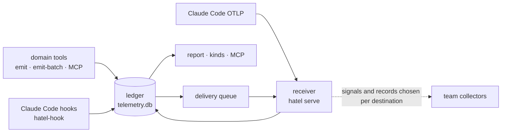
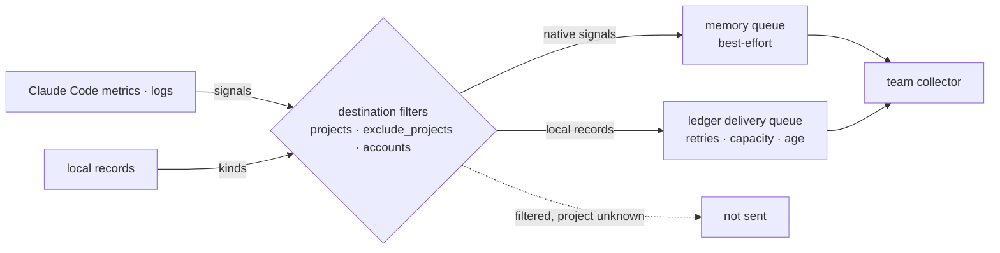

# hatel

[](https://github.com/junyeong-ai/hatel/actions/workflows/ci.yml)

> **[한국어](README.md)** | **English**

**A local telemetry ledger.** It records check outcomes, domain events, state snapshots and Claude Code usage in one SQLite ledger and answers queries through a CLI and MCP. By default nothing leaves the machine.



## What it is for

| Question | What it records | Read with care |
|---|---|---|
| What ran in this repository? | Tool calls, prompts and instruction loads from hooks, under a repository-level project | Repositories sharing a display name can be grouped together. |
| Where did checks spend time? | Outcomes and durations in the common `check` Kind | A failure does not by itself mean a defect or flakiness. |
| What state are rules, reviews and deploys in? | Domain Kinds and state snapshots you define | Facts no producer recorded are unknown. |
| What did each model or agent cost in a period? | Request cost estimates in `claude.api_request` | Not an invoice. |
| How many tokens did the conversation's models and agents use? | Per-response tokens read from session transcripts (`claude.response`) | Side requests such as compaction and summaries are absent, so never add it to `claude.api_request`. |
| What should go to the organization? | Native signals and local Kinds chosen per destination | Local storage and downstream delivery succeed separately. |

hatel does not rebuild Claude Code’s [native monitoring](https://code.claude.com/docs/en/monitoring-usage); it adds only the signals you need on top. It is not a general OTLP Collector, a tracing backend, a billing ledger or a productivity scorer.

## Getting started

```sh
curl -fsSL https://raw.githubusercontent.com/junyeong-ai/hatel/main/scripts/install.sh | bash
hatel emit check name=lint suite=quality outcome=passed duration_s:=1.25 --receipt
hatel report --kind check --window 7d
```

The installer installs `hatel`, `hatel-hook` and the Claude Code skill. `--version <version>` picks a release; in a checkout, `bash scripts/install.sh --source` builds it. `scripts/uninstall.sh` leaves collected data and configuration in place.

Local recording and queries need neither Claude Code nor the receiver. To collect Claude Code usage as well:

```sh
hatel init                          # wire telemetry env and hooks into user settings.json
hatel service                       # run the receiver as a background service (launchd / systemd --user)
claude mcp add hatel -- hatel mcp   # register the MCP tools for agents
hatel doctor                        # check the wiring
```

`init` keeps existing hooks and organization destinations. `--scope project` and `--scope local` wire hooks only. When managed policy locks hooks or destinations, `doctor` says what remains possible.

## Commands by question

| What you want to know | Command |
|---|---|
| Kinds and fields that can be recorded | `hatel kinds --json` |
| The last 30 days with session costs | `hatel report --window 30d` |
| Request cost by model over 7 days | `hatel report --kind claude.api_request --group-by model --window 7d` |
| Conversation tokens by model over 7 days | `hatel report --kind claude.response --group-by model --window 7d` |
| Failed checks | `hatel report --kind check --filter outcome=failed --group-by name --top 0` |
| Successful skill calls | `hatel report --kind tool --filter tool_name=Skill --filter ok=1 --group-by skill` |
| Instruction files loaded into context | `hatel report --kind memory --group-by file_path` |
| Sessions started on one branch | `hatel report --kind session --filter branch=main --group-by session_id --top 0` |
| Only the current repository | `hatel report --project "$PWD"` |

`--filter` (repeatable, exact match), `--group-by` and `--sort-by` go with `--kind`. `--top` shows 5 items per list by default and all with `0`, and states the count before the cut. Use `--format json` for machines. A path given to `--project` selects the repository it is in (a linked worktree included); a path outside every repository is rejected.

## Reading results

- **Read a sum with its measurement count.** Read `sum` with `valid_count`. In human tables `—` means unmeasured, `7 (1/3)` a sum over the one measured record of three, and `0` a measured zero.
- **An empty answer is not necessarily zero.** Check the section `error`, `storage_error`, `cost_error` and `unreadable_kinds` first.
- **Check what is retained.** `retained_since` is the time of the oldest retained record. Later than the window start (`since`), it means the window’s earlier part holds no retained record.
- **There are two cost bases.** The `cost` section is lifetime session totals selected by last activity (`cost_basis`); request cost that occurred in the window comes from `claude.api_request`. Neither is an invoice, and the `session` cache-write estimate is a forecast never added to them.
- **An event Kind that declares `identity`** counts the earliest record per ID in each group. This is not deduplication at storage time.

Each Kind section answers under its current contract and counts records under other contracts in `contracts`, by `resolution`.

| `resolution` | The record’s contract | Aggregated |
|---|---|---|
| `selected` | The answering definition itself | Yes |
| `compatible` | Same name, version and mode (and identity for a snapshot); every field the answering definition declares keeps its type, unit and hashing; every field it requires was required when written | Yes |
| `incompatible` | Fails the conditions above | Counted only |
| `undefined` | No known definition | Counted only |

To answer under another stored contract, find its `schema_id` in `stored_contracts` of `hatel kinds --json` and pass it as `--contract` with `--kind`. Kinds no longer written are queried the same way.

## Custom Kinds

A schema TOML defines only the data contract; outcomes and verdicts are recorded by the producer that knows them. Reuse the common `check` for plain command runs, and add a namespaced Kind such as `team.deploy` only when the domain adds meaning. Add schema files to `plugins` in `config.toml`.

```toml
[[kind]]
name = "team.deploy"
version = 1
fields = { service = { type = "string", required = true }, outcome = { type = "string", required = true }, duration_s = { type = "number", unit = "s" }, actor = { type = "string" } }
group_key = "service"
measures = ["duration_s"]
redact = ["actor"]
```

```sh
hatel emit team.deploy service=api outcome=passed duration_s:=3.2 --receipt
hatel emit team.deploy --json '{"service":"api","outcome":"passed"}' --context '{"source":"release-tool","run_id":"run-123"}'
printf '%s\n' '[{"kind":"check","payload":{"name":"lint","outcome":"passed"}}]' | hatel emit-batch
```

- Field types are `string`, `number`, `integer`, `boolean`, `array`, `object` and `any`, with requiredness and units. Fields listed in `redact` are hashed before storage.
- A record with a wrong type or a missing required field is refused before storage. Undeclared payload fields are dropped with a warning, or refused under `HATEL_STRICT=1`.
- `key=value` is a string and `key:=value` is JSON. `--context` takes `occurred_at`, `source`, `run_id` and `correlation_id`.
- The common `metadata.project` comes from the Git repository of the working directory; outside one, no project is made up.
- A receipt confirms local storage. `delivery` is the outcome of queueing, not of downstream receipt.

| Exit code | `emit` | `emit-batch` |
|---|---|---|
| 0 | Stored | All stored |
| 1 | Configuration, registry or store unusable | Some items not stored |
| 2 | Input refused by validation | The call failed before any item |

A batch returns `stored`, `rejected` or `failed` per item in input order and is not atomic, so resend only the items not stored. Limits are 8 MiB of CLI stdin, 4096 items per batch and 256 KiB per sanitized payload. The MCP SDK drops a message above 16 MiB without a reply.

### State snapshots

```toml
[[kind]]
name = "team.review"
mode = "snapshot"
identity = "review_id"
fields = { review_id = { type = "string", required = true }, outcome = { type = "string" }, unresolved = { type = "integer" } }
group_key = "outcome"
measures = ["unresolved"]
```

A snapshot report first selects the latest record per project and ID in the window, then filters and groups. So once the latest state is resolved, an `unresolved` filter does not bring back an older state. Entities unchanged within the window are absent, so the result is not a complete current inventory.

### Contract changes

| Change | Earlier records |
|---|---|
| Adding an optional field, removing a field, making a required field optional | Still read |
| Changing a type, unit or hashing; a newly required field; a changed snapshot identity | Counted, not read |
| Changing `group_key` or `measures` | The contract does not change |

Change the Kind name or `version` explicitly when meaning changes. A pending delivery is cancelled once its contract becomes incompatible or it carries a removed field.

### Hook bindings

Fields actually present in lifecycle hook input can be recorded with declarative bindings (`from`, JSON Pointer, `const`, `len`, `when` conditions and more). Tool names or free text never stand in for deploy success or quality. See the [example](plugins/example.toml) for the format.

## Storage and retention

Configuration is `$HATEL_CONFIG`, otherwise the platform’s `hatel/config.toml` (Unix `~/.config/hatel/config.toml`, Windows `%APPDATA%\hatel`). Hooks, CLI, MCP and the receiver all read this file.

```toml
plugins = ["schemas/team.toml"]

[storage]
# state_dir = "/data/hatel"
retention_days = 90

[storage.kinds."claude.hook"]
retention_days = 14
```

- The ledger is one SQLite database, `telemetry.db`, in the state directory. Relative paths resolve against the configuration file; `~` is not expanded.
- `retention_days` is every Kind’s default number of days kept; `[storage.kinds."<Kind>"]` sets one Kind’s own.
- The receiver periodically deletes records past their retention and returns the freed space to the file system. A shortened retention applies once the receiver restarts, and nothing is deleted while the configuration file cannot be read.
- `hatel doctor --local` names the actual configuration file and ledger, the ledger’s size and the Kinds holding the most records.
- A store at a schema this build did not create is refused for reads and writes and never altered. Moving `telemetry.db` aside starts a new store. Back up a live ledger with the [SQLite backup API](https://www.sqlite.org/backup.html).

| Variable | Purpose |
|---|---|
| `HATEL_CONFIG` | Selects the configuration file |
| `HATEL_PLUGINS` | Replaces the plugin list for one process (`:` on Unix, `;` on Windows) |
| `HATEL_STATE_DIR`, `HATEL_RETENTION_DAYS`, `HATEL_ROTATE_BYTES` | Replace a `[storage]` value for one process |
| `HATEL_DISABLED=1` | Turns local recording off |
| `HATEL_STRICT=1` | Refuses undeclared payload fields |
| `HATEL_TESTING=1` | Keeps state under `_test/` |

A variable applies only to the process that receives it, so passing one to hooks alone splits the service from the ledger. Keep shared settings in `config.toml`.

## Delivering to a team

Each destination is one `[[export]]` choosing Claude Code’s native signals (`signals`) and local records (`kinds`) separately.



```toml
[[export]]
endpoint = "https://collector.example.com"
mode = "enriched"
signals = ["metrics"]
kinds = ["check", "team.deploy"]
projects = ["/absolute/repository/path"]
# headers = { authorization = "Bearer ..." }
```

- Omitted `signals` sends metrics and logs; omitted `kinds` sends no local records. `signals = []` sends local records alone.
- `raw` forwards the received body as is; `enriched` sends JSON with the project label added. Native bodies are not hashed locally.
- Records selected by `kinds` enter the queue in the same transaction as the ledger, and the receiver retries them under the same `record_id`. A lost acknowledgement can duplicate a delivery. Check states with `hatel deliveries --json`.
- `accounts` allow-lists Claude sign-in emails. It applies to native signals only, so it cannot be combined with `kinds`.
- To insert hatel in front of an existing organization collector, run `hatel init --insert --mode enriched` and review the generated `[[export]]`.

## The Claude Code adapter

| Signal | Local handling | Caveat |
|---|---|---|
| Cost, token, active-time and lines-of-code metrics | Per-session totals | Metrics without `session.id` are dropped, not guessed |
| `api_request` events | Safe fields only, as `claude.api_request` | A request cost estimate, not a charge |
| `hook_execution_complete` events | Completed batch counts and total duration in `claude.hook` | Cannot be split into individual hook latency |
| Session transcripts | Per-response tokens as `claude.response` when a turn, subagent or session ends | Kept even when managed settings send native signals elsewhere, but without side requests or cost |
| Lifecycle hooks | Tool calls, prompt length, session starts, subagents, commands, instruction loads | Some events fire again on every resume |
| OTLP traces | Unsupported (HTTP 501) | Use a separate tracing collector |

- Local decoding covers uncompressed HTTP/JSON. Duplicate attribute keys and wrong types are never turned into empty strings or zeros.
- A project comes first from the repository hooks observed for the session. A session whose start was not seen can be identified by the browser URL in `vcs.repository.url.full`.
- `tool` duration ends when the call returns, so a background command holds only its acceptance time. A missing instruction-load record does not mean the file was absent from context.
- A `session` start records the branch checked out at the time. A branch’s cost is the `cost` rows of those sessions: whole-session totals.

## Operations and privacy

```sh
hatel doctor --json
hatel doctor --local --json
hatel service --restart
```

- `doctor` checks through to Claude Code wiring; `--local` checks only local recording, schemas, storage and delivery. It sees this process’s environment only and makes no claim about another session’s. What it does report from observation: sessions whose responses were recorded but whose native telemetry never arrived, and batches the receiver failed to forward.
- After an upgrade, restart the receiver with `hatel service --restart` and reconnect the MCP server in Claude Code through `/mcp` → `hatel` → `Reconnect`. The conversation stays open.
- Receiver logs are `~/Library/Logs/hatel/serve.log` on macOS and `journalctl --user -u hatel` on Linux.
- Built-in Kinds store no raw prompts, command output or arbitrary tool input. The ledger holds local repository paths and identifiers, so treat it as sensitive. Hashing does not guarantee anonymity.
- A failed hook write never blocks work; it leaves a diagnostic. hatel does not promise exactly-once across the whole path and derives no saved time or ROI from observed numbers.

## Development

`crates/core` is the async-free schema, ledger and query library, `crates/hook` the hook executable, and `crates/cli` the receiver, CLI and MCP server. Development rules are in [CLAUDE.md](CLAUDE.md) and the shipped agent guidance in [SKILL.md](.claude/skills/hatel/SKILL.md). Report problems in [GitHub Issues](https://github.com/junyeong-ai/hatel/issues).

## License

MIT OR Apache-2.0. See [LICENSE-MIT](LICENSE-MIT) and [LICENSE-APACHE](LICENSE-APACHE).
