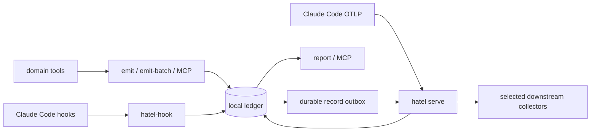

# hatel

[](https://github.com/junyeong-ai/hatel/actions/workflows/ci.yml)

> **English** | **[한국어](README.md)**

**Local telemetry records and queries.** Store check executions, domain events and state snapshots in one ledger; query them through CLI or MCP. The Claude Code adapter connects native OpenTelemetry with lifecycle hooks. Forwarding is off by default.

## What it adds

Claude Code already provides cost, tokens, active time, tool events and repository attributes. Hatel adds local workflows around those signals. Check the [native monitoring scope](https://code.claude.com/docs/en/monitoring-usage) and collect the signals you need.

| Question | Added capability | Interpretation limit |
|---|---|---|
| What ran in this repository? | Hooks, common project keys and local history | Several repositories may share a display label. |
| Which checks took time? | Common `check`, producer-observed outcomes and durations | Failure alone establishes neither a defect nor flakiness. |
| What is the rule, review or deployment state? | Configured domain Kinds and snapshots | Unrecorded producer facts remain unknown. |
| What should reach the organization? | Per-destination native signals and local Kind selection | Local storage and downstream delivery are separate outcomes. |

Hatel focuses on local queries and optional team delivery. Use a full OTLP Collector or backend for general protocol processing and distributed tracing. These records do not establish billing totals, productivity or quality.



## Start

```sh
curl -fsSL https://raw.githubusercontent.com/junyeong-ai/hatel/main/scripts/install.sh | bash
hatel doctor --local
hatel kinds --json
hatel emit check name=lint suite=quality outcome=passed duration_s:=1.25 --receipt
hatel report --kind check --window 7d --format json
```

The installer ships `hatel`, `hatel-hook` and a self-contained skill. Select a release with `--version <version>`; from a checkout, build with `bash scripts/install.sh --source`. `scripts/uninstall.sh` keeps collected data and configuration.

For Claude Code, run the following. Native metrics and logs need the receiver running when emitted. Ordinary local recording and queries need neither Claude Code nor a receiver.

```sh
hatel init
hatel doctor
hatel serve --all
# Background service (macOS launchd / Linux systemd --user)
hatel service
claude mcp add hatel -- hatel mcp
```

`init` preserves existing hooks and a repointed organizational endpoint. `--scope project` and `--scope local` wire hooks only. Native telemetry enablement and destinations belong in the launch environment, user settings or managed settings. `doctor` reports limits imposed by managed hooks or destination policy.

## Configuration and storage

Configuration is `$HATEL_CONFIG`, otherwise the platform’s `hatel/config.toml`: `~/.config/hatel/config.toml` on Unix, respecting `XDG_CONFIG_HOME`, and `%APPDATA%\hatel` on Windows. `doctor --local` names the actual file and store.

```toml
plugins = ["schemas/team.toml"]

[storage]
# state_dir = "/data/hatel"
retention_days = 90
```

The ledger is one SQLite/WAL database, `telemetry.db`, in the state directory. Relative paths resolve against the configuration file; `~` is not expanded. Default state lives under the platform’s state directory in `hatel`.

Hooks, CLI, MCP and receiver read the same configuration. Preserve existing plugin entries. A project script overriding `HATEL_PLUGINS` can hide other producers’ schemas. Restart the receiver after configuration changes. Before deletion it rereads retention and deletes nothing if that read fails.

A store holding records at a schema this build did not create refuses writes and is never altered; `doctor --local` and `/healthz` report it. Offline backups preserve configuration, ledger, costs and session state together; use the [backup API](https://www.sqlite.org/backup.html) for live SQLite.

| Variable | Purpose |
|---|---|
| `HATEL_CONFIG` | Select configuration file |
| `HATEL_PLUGINS` | Replace plugins for one process; `:` on Unix, `;` on Windows |
| `HATEL_STATE_DIR`, `HATEL_RETENTION_DAYS`, `HATEL_ROTATE_BYTES` | Override the corresponding storage setting |
| `HATEL_DISABLED=1` | Disable local recording |
| `HATEL_STRICT=1` | Reject payload fields outside the allow-list |
| `HATEL_TESTING=1` | Separate state under `_test/` |

Storage overrides inherited only by hooks split the store from the service. Put shared settings in `config.toml`. Invalid settings and variable values are reported as errors. `rotate_bytes` limits session index segment size, not total disk usage. Retention runs in the receiver; a stopped receiver performs no automatic pruning.

## Query and interpret

```sh
hatel kinds --json
hatel report --window 30d --format json
hatel report --kind check --filter outcome=failed --group-by name --top 0
hatel report --kind check --group-by metadata.source --sort-by duration_s
hatel report --kind claude.api_request --group-by model --window 7d
hatel report --kind tool --filter tool_name=Skill --filter ok=1 --group-by skill
hatel report --kind memory --group-by file_path
hatel report --project /absolute/repository/path --format json
```

`--group-by`, `--sort-by` and repeatable `--filter field=value` require `--kind`. Filters match exactly and all must match. Empty strings differ from absent fields. Filter hashed payload fields by their original value. `project` uses the common project key, falling back to the payload's `project`, when the Kind declares that field, for records without one. `--project` accepts key or label; use keys to distinguish repositories with equal labels. `--top` (default 5, `0` for all) cuts every list: each Kind's groups, the cost section's sessions (`cost`, ranked by `cost_usd`) and its projects (`cost_groups`). `group_count`, `cost_session_count` and `cost_group_count` give the totals before the cut.

Ordinary Kind `count` counts records. With event-mode `identity`, each group uses the earliest matching record per ID; records without an ID count separately. This is query selection, not storage deduplication. Snapshot mode selects state as described below.

Measures include `sum`, `valid_count`, `missing_count`, `invalid_count`, `avg`, `min`, `max`, `unit` and `buckets`. Numeric strings are not guessed into numbers. Human tables use `—` for unmeasured values; `7 (1/3)` means a sum of 7 over the one measured record out of three. Measured zero stays `0`. Interpret JSON sums with `valid_count`. Duration fields in `s` or `ms` provide fixed cumulative buckets, not estimated percentiles. An aggregate outside the finite numeric range fails that Kind section.

Aggregates use SQLite REAL/f64; integers above 2^53 can lose precision. Record identifiers as strings.

`retained_since` is the oldest retained record, not proof of continuous collection, completeness or whole-period usage. `unreadable_kinds` identifies missing schemas, `storage_error` a failed ledger inspection, and `cost_error` an unreadable cost baseline. Check these with each Kind’s `error`; an empty array after failure is not absence of records. A receiver with an unreadable cost baseline does not rewrite its files; repair the baseline and restart it.

Each section answers under the Kind's current contract, or the one `--contract SCHEMA_ID` selects. Records of another stored contract join it when name, version and mode match, a snapshot keeps its identity, every field the answering definition declares keeps its type, unit and redaction, and every field it requires was required when written. `contracts` counts records per contract with a `resolution`: `selected` and `compatible` records are answered, while `incompatible` records and `undefined` ones without a known definition are excluded. `retained_since` covers answered records only. Inspect definitions in `kinds --json` under `stored_contracts`, then select `report --kind KIND --contract SCHEMA_ID`, including for a retired Kind. Records without a known definition are counted, never interpreted.

## Custom Kinds

Schema TOML defines a data contract. Producers that know the facts record execution outcomes and decisions. Namespace names, such as `team.deploy`. Reuse the built-in `check` for ordinary executions; add a Kind when it carries domain-specific meaning.

```toml
[[kind]]
name = "team.deploy"
version = 1
fields = { service = { type = "string", required = true }, outcome = { type = "string", required = true }, duration_s = { type = "number", unit = "s" }, actor = { type = "string" } }
group_key = "service"
measures = ["duration_s"]
redact = ["actor"]
```

Field types are `string`, `number`, `integer`, `boolean`, `array`, `object` and `any`, with optional requiredness and units. Invalid types and missing required fields are rejected before storage. Unknown configuration and schema keys are rejected. Unknown payload fields are dropped with a warning by default, or rejected in strict mode.

```sh
hatel emit team.deploy service=api outcome=passed duration_s:=3.2 --receipt
hatel emit team.deploy --json '{"service":"api","outcome":"passed"}' \
  --context '{"occurred_at":"2026-10-01T12:00:00Z","source":"release-tool","run_id":"run-123"}' \
  --receipt
printf '%s\n' '[{"kind":"check","payload":{"name":"lint","outcome":"passed","duration_s":1.2},"context":{"source":"quality-tool","run_id":"run-123"}}]' | hatel emit-batch
```

`key=value` is a string; `key:=value` is JSON. Single writes also accept `--json` or an object on stdin. Batches return ordered per-item `stored`, `rejected` or `failed` outcomes; the whole batch is not atomic. A storage receipt confirms local storage. `delivery` reports enqueue outcomes, not downstream acceptance. Inspect warnings and individual failures.

Single writes exit 0 on storage success, 1 when the configuration, registry or store cannot be used, and 2 on input or validation rejection. Batches exit 0 when all store, 1 for item failures or the same environment faults, and 2 for top-level input errors. Over MCP, `emit_batch` sets `isError` only when the whole call fails; resend only the entries not stored. CLI stdin is limited to 8 MiB, batches to 4096 items, and each sanitized payload to 256 KiB. MCP shares record validation; the CLI stdin cap is not an MCP framing limit.

`emit` and MCP attribute common `metadata.project` from the actual Git repository in their working directory. Linked worktrees share their repository identity; outside Git, no project is invented. Run producers in the correct repository directory. Query `metadata.source`, `run_id`, `correlation_id`, `record_id`, `kind_version`, `schema_id`, `observed_at`, `project.key` and `project.label` without redeclaring them per Kind.

### State snapshots

```toml
[[kind]]
name = "team.review"
mode = "snapshot"
identity = "review_id"
fields = { review_id = { type = "string", required = true }, outcome = { type = "string" }, unresolved = { type = "integer" } }
group_key = "outcome"
measures = ["unresolved"]
```

Snapshots select the latest occurrence per project and ID inside the requested project and window, under every stored contract, before filters and grouping. Filtering unresolved items cannot resurrect an older unresolved state after resolution, and an item whose latest state is under an unreadable contract is left out rather than shown in an older state. Observation time breaks equal occurrences; contradictory states tied on both times fail. IDs must be required non-empty strings. Unchanged items outside the window are absent, so this is not a complete current inventory.

Manage Kind names or versions explicitly when meaning or units change. `schema_id` is an opaque `v2:` contract identifier covering fields, units, redaction, mode and identity. SQLite commits validated records with their contract definitions. Changing default grouping or ranking does not change the data contract. Adding an optional field, removing a field or making one optional keeps earlier records readable; a type, unit or redaction change, a newly required field or a changed snapshot identity does not. Pending deliveries continue under a compatible contract and are cancelled under an incompatible one or when they carry a field the definition no longer declares. Historical local records are preserved, never automatically reinterpreted.

### Hook bindings

Declarative bindings can record fields actually present in lifecycle inputs. They support `from`, JSON Pointers, `const`, `capture`, `len`, `present`, `basename`, `repo_path` and exact `when` conditions. Do not infer deployment success, quality or productivity from tool names or free text. Assign one owner so a producer and hook do not record the same fact twice. The [example](plugins/example.toml) demonstrates schemas and bindings.

## Per-destination team delivery

To forward only native Claude metrics, configure the following. It selects no native logs or local custom records.

```toml
[[export]]
endpoint = "https://collector.example.com"
mode = "raw"
signals = ["metrics"]
kinds = []
```

To include selected local Kinds, name them in the exact `kinds` allow-list. This sends sanitized individual records as OTLP logs, not a pre-aggregated report. The team backend owns aggregation and deduplication policy.

```toml
[[export]]
endpoint = "https://collector.example.com"
mode = "enriched"
signals = ["metrics"]
kinds = ["check", "team.deploy"]
projects = ["/absolute/repository/path"]
retry_attempts = 8
queue_days = 7
queue_bytes = 67108864
# headers = { authorization = "Bearer ..." }
```

Omitted `signals` means native metrics and logs; omitted `kinds` means no local records. Use `signals=[]` and selected `kinds` for domain records alone. Configure each destination independently; duplicate endpoints are rejected. Use either `projects` or `exclude_projects`, matching key or label. Batches with unresolved attribution are not sent to project-filtered destinations.

Native OTLP forwarding uses a best-effort memory queue. `raw` relays the body; `enriched` adds a project label to JSON. Native bodies do not pass through the local payload allow-list or hashing. If content capture is enabled upstream, that content may leave the machine.

Selected local Kinds commit their delivery rows with the SQLite record. The receiver retries with the same `record_id` and current policy and contract. Queue capacity does not undo local storage; the receipt reports records not queued. Retention, queue age, retry limits, incompatible contract changes or a removed field may prevent delivery. Lost acknowledgements can cause duplicate delivery.

```sh
hatel deliveries --json
```

Delivery states group by destination, status and error reason. `failed` does not mean local storage failed. Local values outside OTLP’s signed 64-bit integers or known positive unsigned 64-bit nanosecond timestamps fail delivery explicitly while representable neighbors proceed. Rejection before sending does not count as an HTTP attempt. Native local projections are not re-exported alongside their source signal.

To insert before an existing organizational collector, use `hatel init --insert [--mode raw|enriched]` and inspect `signals` and `kinds` in the resulting `[[export]]`. Managed destination locks remain authoritative.

## Claude Code adapter scope

| Signal | Local processing | Caveat |
|---|---|---|
| Native cost, tokens, active time, lines | Per-session sum/gauge totals and dimensional rollups | Missing `session.id` is dropped rather than guessed |
| `api_request` | Safe-field projection to `claude.api_request` | Occurrence-based request cost estimates, not invoices |
| `hook_execution_complete` | Completion-batch counts and total duration in `claude.hook` | Does not measure individual hook latency |
| Lifecycle hooks | Tools, prompt length, starts, subagents, commands, memory loads | Respect each event’s meaning and repeated occurrences |
| OTLP traces | Unsupported, HTTP 501 | Use a tracing collector |

Local decoding covers supported uncompressed HTTP/JSON signals. Metric attributes retain scalar types; compound dimensions report a local aggregation error. Duplicate keys, conflicting values and invalid types do not become empty strings or zero. Unknown protocol fields are ignored. Undecodable bodies can only be relayed best-effort under the configured raw policy. `/healthz` reports build, configuration, storage and supported capabilities.

Attribution prefers the hook-observed session index. For an unseen session, explicit `vcs.repository.url.full` can supply a browser-URL identity. It is not automatically merged with a local Git path. A known session outside a repository is never overwritten by URL attribution.

`cost` contains lifetime session totals selected by last activity (`cost_basis=session_lifetime_totals_selected_by_last_seen`). A `7d` window does not mean spend incurred in those seven days. Use `claude.api_request` for request estimates in an occurrence window. Legacy cost rows without `observed_metrics` have unknown measurement coverage. Session cache-write forecasts are separate estimates and are never added to actual cost. Active time and wall time do not establish idle time by subtraction.

`subagent` counts `agent_id` per group, counting ID-less records separately. Internal agents also emit events, so labels cannot isolate user-created agents. Tool duration ends when the call returns and may only measure acceptance of background work. An absent memory-load announcement does not establish that a document was absent from context.

## Operations, diagnosis and privacy

```sh
hatel doctor --local --json
hatel doctor --json
hatel service --print
hatel service --restart
```

Full diagnosis also checks Claude Code wiring; `--local` checks local recording, registry, storage and delivery. `doctor` observes this process and configuration, not another session’s launch environment. Claude Code strips its `OTEL_*` variables from subprocesses, so a tool’s environment alone cannot establish a session’s actual destination.

After upgrading, restart the receiver and reconnect existing MCP servers to use the new build. In Claude Code, use `/mcp` → `hatel` → `Reconnect` while keeping the conversation open. Services point to the installing binary and preserve hand-edited units. Logs are `~/Library/Logs/hatel/serve.log` on macOS and `journalctl --user -u hatel` on Linux. Resolve configuration, storage and missing-schema findings before interpreting empty reports.

Built-in local Kinds do not store raw prompts, command output or arbitrary tool inputs. Operators own custom-schema data selection. Hashing does not guarantee anonymity. Common metadata can contain repository paths and identifiers; treat ledgers and reports as sensitive local data. Custom delivery omits the local path key but includes project labels and selected fields and IDs.

Lifecycle hook storage failures report diagnostics without blocking work. CLI and MCP writes distinguish storage success from failure. Native delta metrics, hook events and retries after lost acknowledgements can duplicate; Hatel does not guarantee end-to-end exactly-once processing. Observation counts alone do not establish prevented defects, saved time or ROI.

## Development and support

`crates/core` owns schemas, ledger and queries without an async runtime; `crates/hook` runs hooks; `crates/cli` owns the receiver, CLI and MCP. Vendor interpretation belongs in adapters, domain decisions in producers. See [CLAUDE.md](CLAUDE.md) for development checks and constraints and [SKILL.md](.claude/skills/hatel/SKILL.md) for shipped agent guidance.

Report issues through [GitHub Issues](https://github.com/junyeong-ai/hatel/issues). Inspect command contracts with `hatel <command> --help` and `hatel kinds --json`.

## License

MIT OR Apache-2.0. See [LICENSE-MIT](LICENSE-MIT) and [LICENSE-APACHE](LICENSE-APACHE).
