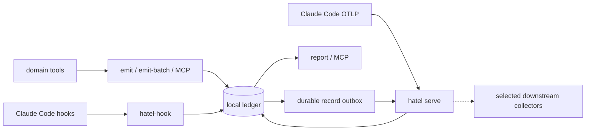

# hatel

[](https://github.com/junyeong-ai/hatel/actions/workflows/ci.yml)

> **한국어** | **[English](README.en.md)**

**로컬 텔레메트리 기록·조회 도구.** 검사의 실행 결과, 도메인 이벤트, 상태 스냅샷을 같은 원장에 저장하고 CLI와 MCP로 조회한다. Claude Code 어댑터는 기본 OpenTelemetry와 라이프사이클 훅을 연결한다. 기본 설정에서는 외부로 전달하지 않는다.

## 어떤 가치를 제공하는가

Claude Code는 이미 비용·토큰·활동 시간, 도구 이벤트와 저장소 속성을 제공한다. Hatel의 가치는 이 수치를 다시 만드는 데 있지 않다. [기본 모니터링의 범위](https://code.claude.com/docs/en/monitoring-usage)를 확인하고 필요한 신호만 수집한다.

| 질문 | Hatel의 추가 기능 | 해석의 한계 |
|---|---|---|
| 특정 저장소에서 무엇을 실행했는가? | 훅·공통 프로젝트 키·로컬 이력 | 같은 표시 이름은 여러 저장소를 포함할 수 있다. |
| 검사 중 어디에 시간이 들었는가? | 공통 `check`, 생산자가 관찰한 결과와 소요 시간 | 실패가 결함이나 불안정성을 뜻하지 않는다. |
| 규칙·리뷰·배포 상태는 어떤가? | 설정으로 정의한 도메인 Kind와 스냅샷 | 생산자가 기록하지 않은 사실은 알 수 없다. |
| 조직으로 무엇을 보낼 것인가? | 목적지별 기본 신호와 로컬 Kind 선택 | 외부 전달과 로컬 저장의 성공은 별개다. |

Hatel은 개인·로컬 도구의 조회와 선택적 팀 전달에 초점을 둔다. 범용 OTLP Collector, 분산 추적 백엔드, 청구 원장, 생산성·품질 평가 엔진을 대체하지 않는다.



## 시작하기

```sh
curl -fsSL https://raw.githubusercontent.com/junyeong-ai/hatel/main/scripts/install.sh | bash
hatel doctor --local
hatel kinds --json
hatel emit check name=lint suite=quality outcome=passed duration_s:=1.25 --receipt
hatel report --kind check --window 7d --format json
```

설치기는 `hatel`, `hatel-hook`, 단독 실행 가능한 스킬 파일을 설치한다. `--version <version>`으로 배포본을 선택하고, 체크아웃에서는 `bash scripts/install.sh --source`로 빌드할 수 있다. 제거는 `scripts/uninstall.sh`를 사용하며 수집한 데이터와 설정은 남는다.

Claude Code를 연결하려면 다음을 실행한다. 기본 지표·로그는 수신기가 실행 중일 때 수집된다. 일반 로컬 기록·조회에는 Claude Code나 수신기가 필요하지 않다.

```sh
hatel init
hatel doctor
hatel serve --all
# Background service (macOS launchd / Linux systemd --user)
hatel service
claude mcp add hatel -- hatel mcp
```

`init`은 기존 훅과 별도로 지정된 조직 엔드포인트를 보존한다. `--scope project`와 `--scope local`은 훅만 설정한다. 기본 텔레메트리의 활성화·목적지는 실행 환경, 사용자 설정 또는 관리 설정에 둔다. 관리 정책에 의해 훅이나 목적지 변경이 막히면 `doctor`가 가능한 범위를 알려 준다.

## 설정과 저장소

설정은 `$HATEL_CONFIG`, 없으면 플랫폼의 `hatel/config.toml`이다. Unix 기본 경로는 `~/.config/hatel/config.toml`이며 `XDG_CONFIG_HOME`을 따른다. Windows에서는 `%APPDATA%\hatel`이다. `doctor --local`이 실제 파일과 저장소를 표시한다.

```toml
plugins = ["schemas/team.toml"]

[storage]
# state_dir = "/data/hatel"
retention_days = 90
```

원장은 상태 디렉터리의 SQLite/WAL 데이터베이스 `telemetry.db` 하나다. 상대 경로는 설정 파일 기준이고 `~`는 확장하지 않는다. 기본 상태 경로는 플랫폼의 상태 디렉터리 아래 `hatel`이다.

훅·CLI·MCP·수신기는 같은 설정을 읽는다. 플러그인 목록을 바꿀 때 기존 항목을 보존한다. 프로젝트 스크립트가 `HATEL_PLUGINS`로 운영자의 레지스트리를 덮어쓰면 다른 생산자의 스키마가 사라질 수 있다. 수신기는 설정 변경 후 재시작한다. 삭제 전에는 보존 기간을 다시 읽고 읽기에 실패하면 삭제하지 않는다.

이 빌드가 만들지 않은 스키마로 기록을 담은 저장소는 읽기와 쓰기를 거부하며 변경하지 않는다. `doctor --local`과 `/healthz`가 이 상태를 알린다. `telemetry.db`를 다른 곳으로 옮기면 새 저장소로 시작한다. 오프라인 백업에는 설정·원장·비용·세션 상태를 함께 보존하고, 실행 중인 SQLite는 [backup API](https://www.sqlite.org/backup.html)를 사용한다.

| 변수 | 용도 |
|---|---|
| `HATEL_CONFIG` | 설정 파일 선택 |
| `HATEL_PLUGINS` | 한 프로세스의 플러그인 목록 대체. Unix `:`, Windows `;` 구분 |
| `HATEL_STATE_DIR`, `HATEL_RETENTION_DAYS`, `HATEL_ROTATE_BYTES` | 해당 저장 설정 대체 |
| `HATEL_DISABLED=1` | 로컬 기록 비활성화 |
| `HATEL_STRICT=1` | 허용되지 않은 페이로드 필드 거절 |
| `HATEL_TESTING=1` | 상태를 `_test/` 아래로 분리 |

저장 관련 변수가 훅에만 전달되면 서비스와 원장이 나뉜다. 공통 설정은 `config.toml`에 둔다. 잘못된 변수·설정 값은 오류로 알린다. `rotate_bytes`는 세션 색인의 파일 크기 기준이며 전체 디스크 용량 제한은 아니다. 보존 삭제는 수신기가 수행하므로 중지 중에는 자동 삭제되지 않는다.

## 조회와 해석

```sh
hatel kinds --json
hatel report --window 30d --format json
hatel report --kind check --filter outcome=failed --group-by name --top 0
hatel report --kind check --group-by metadata.source --sort-by duration_s
hatel report --kind claude.api_request --group-by model --window 7d
hatel report --kind tool --filter tool_name=Skill --filter ok=1 --group-by skill
hatel report --kind memory --group-by file_path
hatel report --project "$PWD" --format json
```

`--group-by`, `--sort-by`, 반복 가능한 `--filter field=value`는 `--kind`와 함께 사용한다. 필터는 정확히 일치해야 하며 모두 만족해야 한다. 빈 문자열과 누락은 구분한다. 해시 처리된 페이로드 필드는 원래 값으로 필터링한다. `project`는 공통 프로젝트 키를 우선하고, 공통 키가 없는 기록은 Kind가 `project` 필드를 선언했을 때 페이로드의 `project`를 사용한다. `--project`에 절대 경로를 주면 그 경로가 속한 저장소를 고른다(linked worktree와 하위 디렉터리 포함). 그 밖의 값은 키 또는 표시 이름에 일치한다. 어느 저장소에도 속하지 않는 경로는 거부하며, 표시 이름은 이름이 같은 저장소를 함께 고를 수 있다. `--top`(기본 5, `0`이면 전체)은 Kind별 그룹, 비용 섹션의 세션(`cost`, `cost_usd` 내림차순)과 프로젝트(`cost_groups`) 목록을 모두 자른다. 자르기 전 개수는 `group_count`, `cost_session_count`, `cost_group_count`가 알려 준다.

일반 Kind의 `count`는 기록 수다. 이벤트 모드에서 `identity`를 선언하면 그룹별 ID의 가장 이른 일치 기록을 대표로 고르고, ID가 없는 기록은 각각 센다. 이는 저장 시 중복 제거가 아니다. 스냅샷 모드는 아래 규칙으로 최신 상태를 고른다.

수치에는 `sum`, `valid_count`, `missing_count`, `invalid_count`, `avg`, `min`, `max`, `unit`, `buckets`가 있다. 숫자 문자열은 수치로 추측하지 않는다. 사람이 읽는 표에서 `—`는 미측정이고 `7 (1/3)`은 기록 3개 중 수치가 있는 1개의 합계가 7이라는 뜻이다. 실제 측정된 0은 `0`이다. JSON의 수치는 `valid_count`와 함께 해석한다. `s`·`ms` 기간 필드는 고정 경계의 누적 버킷을 제공하며 백분위수를 추정하지 않는다. 합계가 유한수 범위를 넘으면 해당 Kind가 오류를 반환한다.

집계는 SQLite REAL/f64를 사용하므로 2^53을 넘는 정수는 정밀도가 손실될 수 있다. 식별자는 문자열로 기록한다.

`retained_since`는 아직 남아 있는 가장 오래된 기록 시각이다. 연속 수집, 누락 없음, 해당 기간의 전체 사용량을 보장하지 않는다. `retained_since`가 null이면 그 범위에 보존된 기록이 하나도 없다는 뜻이며, 텍스트 출력은 이를 `no records in this window`가 아니라 `no records retained`로 표시한다. `unreadable_kinds`는 스키마 미등록, `storage_error`는 원장 검사 실패, `cost_error`는 비용 이력 읽기 실패를 뜻한다. Kind의 `error`와 함께 확인한다. 실패한 빈 배열을 기록 없음으로 해석하지 않는다. 비용 기준값을 읽지 못한 수신기는 해당 파일을 갱신하지 않으며, 복구 후 재시작이 필요하다.

각 섹션은 Kind의 현재 계약, 또는 `--contract SCHEMA_ID`로 선택한 계약을 기준으로 답한다. 다른 저장 계약의 기록은 이름·버전·모드가 같고, 스냅샷이면 identity도 같고, 답하는 정의가 선언한 모든 필드의 타입·단위·해시 처리가 같으며, 그 정의가 필수로 요구하는 필드가 기록 당시에도 필수였을 때 함께 집계한다. `contracts`는 계약별 기록 수와 `resolution`을 표시한다. `selected`와 `compatible` 기록은 집계에 포함하고, `incompatible` 기록과 정의를 알 수 없는 `undefined` 기록은 제외한다. `retained_since`도 집계한 기록만 기준으로 한다. `kinds --json`의 `stored_contracts`에서 정의를 확인하고 `report --kind KIND --contract SCHEMA_ID`로 선택한다. 은퇴한 Kind도 같은 방식으로 조회한다. 정의를 알 수 없는 기록은 건수만 세고 해석하지 않는다.

## 커스텀 Kind

스키마 TOML은 데이터 계약만 정의한다. 실행 결과·판정은 그 사실을 아는 생산자가 기록한다. 이름은 `team.deploy`처럼 네임스페이스를 사용한다. 단순한 검사 실행에는 기본 `check`를 재사용하고 도메인별 의미가 추가될 때만 Kind를 만든다.

```toml
[[kind]]
name = "team.deploy"
version = 1
fields = { service = { type = "string", required = true }, outcome = { type = "string", required = true }, duration_s = { type = "number", unit = "s" }, actor = { type = "string" } }
group_key = "service"
measures = ["duration_s"]
redact = ["actor"]
```

형식은 `string`, `number`, `integer`, `boolean`, `array`, `object`, `any`이며 필수 여부와 단위를 선언할 수 있다. 잘못된 타입·필수 필드 누락은 저장 전에 거절한다. 알 수 없는 설정·스키마 키도 거절한다. 알 수 없는 페이로드 필드는 기본적으로 경고 후 제거하며 strict 모드에서는 거절한다.

```sh
hatel emit team.deploy service=api outcome=passed duration_s:=3.2 --receipt
hatel emit team.deploy --json '{"service":"api","outcome":"passed"}' \
  --context '{"occurred_at":"2026-10-01T12:00:00Z","source":"release-tool","run_id":"run-123"}' \
  --receipt
printf '%s\n' '[{"kind":"check","payload":{"name":"lint","outcome":"passed","duration_s":1.2},"context":{"source":"quality-tool","run_id":"run-123"}}]' | hatel emit-batch
```

`key=value`는 문자열, `key:=value`는 JSON이다. 단건은 `--json` 또는 표준입력 객체도 받는다. 배치는 항목별 `stored`·`rejected`·`failed` 결과를 입력 순서대로 반환하며 전체 배치의 원자성을 보장하지 않는다. 저장 성공의 영수증은 로컬 저장 완료를 뜻한다. `delivery`는 대기열 등록 결과이며 외부 수신 완료가 아니다. 경고와 항목별 실패를 확인해야 한다.

단건은 성공 0, 설정·레지스트리·저장소를 쓸 수 없으면 1, 입력·검증 거절 2로 종료한다. 배치는 전부 저장되면 0, 일부 항목이 저장되지 않으면 1, 항목을 처리하기 전에 호출이 실패하면(잘못된 입력, 쓸 수 없는 설정이나 레지스트리) 2다. 항목별 결과는 0과 1일 때만 출력한다. MCP의 `emit_batch`는 호출 전체가 실패했을 때만 `isError`를 표시하므로 저장되지 않은 항목만 다시 보낸다. CLI 표준입력은 8MiB, 배치는 4096개, 각 정제된 페이로드는 256KiB로 제한한다. MCP는 같은 기록 검증을 사용하며, MCP SDK는 16MiB를 넘는 메시지 하나를 응답 없이 버리므로 더 큰 배치는 나눠 보낸다.

`emit`과 MCP는 실행 디렉터리의 실제 Git 저장소를 공통 `metadata.project`에 기록한다. 연결된 worktree는 원본 저장소로 집계하고 저장소 밖에서는 프로젝트를 만들지 않는다. 올바른 저장소 디렉터리에서 실행해야 한다. `metadata.source`, `run_id`, `correlation_id`, `record_id`, `kind_version`, `schema_id`, `observed_at`, `project.key`, `project.label`은 Kind마다 재선언하지 않고 조회할 수 있다.

### 상태 스냅샷

```toml
[[kind]]
name = "team.review"
mode = "snapshot"
identity = "review_id"
fields = { review_id = { type = "string", required = true }, outcome = { type = "string" }, unresolved = { type = "integer" } }
group_key = "outcome"
measures = ["unresolved"]
```

스냅샷은 요청한 프로젝트·기간 안에서 모든 저장 계약의 기록을 대상으로 프로젝트와 ID별 최신 발생 기록을 먼저 선택한 뒤 필터·그룹화를 적용한다. 따라서 최신 상태가 해결됨이면 `unresolved` 필터가 오래된 미해결 상태를 되살리지 않는다. 최신 상태가 읽을 수 없는 계약으로 기록된 항목도 오래된 상태로 보여 주지 않고 제외한다. 발생 시각이 같으면 관찰 시각을 사용하며 두 시각이 같은 상충 상태는 오류다. ID는 필수 비어 있지 않은 문자열이어야 한다. 기간 밖의 변경 없는 항목은 빠지므로 결과는 현재 전체 재고가 아니다.

계약의 의미·단위를 바꿀 때는 Kind 이름 또는 버전을 명시적으로 관리한다. `schema_id`는 필드·단위·해시 처리·모드·identity를 포함한 불투명한 `v2:` 계약 식별자다. SQLite는 검증된 기록과 계약 정의를 같은 트랜잭션으로 보존한다. 기본 그룹·정렬 변경은 데이터 계약을 바꾸지 않는다. 선택 필드를 추가하거나, 필드를 제거하거나, 필수 필드를 선택으로 바꾸면 이전 기록을 계속 읽을 수 있다. 타입·단위·해시 처리를 바꾸거나, 필드를 새로 필수로 만들거나, 스냅샷의 identity를 바꾸면 읽을 수 없다. 전송 대기 기록은 호환되는 계약이면 계속 전송하고, 호환되지 않는 계약이거나 정의에서 제거된 필드를 담고 있으면 취소한다. 과거 로컬 데이터는 보존하며 자동으로 재해석하지 않는다.

### 훅 바인딩

라이프사이클 입력에 실제 존재하는 필드는 선언적 바인딩으로 기록할 수 있다. `from`, JSON Pointer, `const`, `capture`, `len`, `present`, `basename`, `repo_path`, 정확한 `when` 조건을 지원한다. 도구 이름이나 자유 텍스트로 배포 성공·품질·생산성을 추론하지 않는다. 생산자 기록과 훅 바인딩이 같은 사실을 중복 기록하지 않도록 소유자를 정한다. [예제](plugins/example.toml)는 스키마와 바인딩 형식을 보여 준다.

## 목적지별 팀 전달

기본 Claude 지표만 전달하려면 다음처럼 설정한다. 이 설정은 기본 로그와 로컬 커스텀 기록을 보내지 않는다.

```toml
[[export]]
endpoint = "https://collector.example.com"
mode = "raw"
signals = ["metrics"]
kinds = []
```

필요한 로컬 Kind만 추가하려면 `kinds`의 정확한 허용 목록을 지정한다. 이는 집계 보고서가 아니라 정제된 개별 기록을 OTLP 로그로 보내는 기능이다. 팀 백엔드가 집계와 중복 제거 정책을 정한다.

```toml
[[export]]
endpoint = "https://collector.example.com"
mode = "enriched"
signals = ["metrics"]
kinds = ["check", "team.deploy"]
projects = ["/absolute/repository/path"]
retry_attempts = 8
queue_days = 7
queue_bytes = 67108864
# headers = { authorization = "Bearer ..." }
```

`signals` 생략 시 기본 지표·로그, `kinds` 생략 시 로컬 Kind 없음이다. `signals=[]`와 선택한 `kinds`로 도메인 기록만 보낼 수도 있다. 목적지마다 별도로 설정하며 같은 엔드포인트의 중복 정의는 거절한다. `projects`와 `exclude_projects`는 둘 중 하나만 사용하고 키 또는 표시 이름에 일치한다. 필터가 있는 목적지로는 프로젝트를 확인하지 못한 배치를 보내지 않는다.

기본 OTLP 전달은 메모리 대기열의 best-effort 방식이다. `raw`는 원문을, `enriched`는 프로젝트 표시 이름을 추가한 JSON을 전달한다. 기본 원문은 로컬 페이로드 허용 목록·해시 처리를 거치지 않는다. 내용 수집을 켰다면 그 내용도 나갈 수 있다.

선택한 로컬 Kind는 SQLite 기록과 전송 행을 함께 커밋한다. 수신기가 재시도할 때 동일한 `record_id`를 유지하고 최신 정책·계약을 확인한다. 큐 용량 초과는 로컬 저장을 취소하지 않으며 영수증에 미등록 수를 알린다. 보존 삭제·기간 만료·시도 한도·호환되지 않는 계약 변경·필드 제거로 전송하지 못할 수 있다. 응답 유실에 따른 중복 전달은 가능하다.

```sh
hatel deliveries --json
```

상태는 목적지·상태·오류 이유별로 집계된다. `failed`는 저장 실패를 뜻하지 않는다. OTLP의 signed 64-bit 정수나 양수 unsigned 64-bit 나노초 시각으로 표현할 수 없는 로컬 값은 명시적으로 전송 실패가 되고 다른 정상 기록은 전달한다. 전송 전 거절은 HTTP 시도 횟수에 포함하지 않는다. 로컬 네이티브 투영은 원본과 함께 다시 내보내지 않는다.

기존 조직 수집기 앞에 삽입하려면 `hatel init --insert [--mode raw|enriched]`를 사용하고 생성된 `[[export]]`의 `signals`와 `kinds`를 검토한다. 관리 정책이 목적지를 잠그면 이를 우회하지 않는다.

## Claude Code 어댑터의 범위

| 신호 | 로컬 처리 | 주의점 |
|---|---|---|
| 기본 비용·토큰·활동 시간·코드 줄 수 | 세션별 sum/gauge와 차원별 누적값 | `session.id`가 없으면 추측하지 않고 제외 |
| `api_request` | 안전한 필드만 `claude.api_request`로 투영 | 발생 시각 기준 요청 비용 추정치이며 청구액 아님 |
| `hook_execution_complete` | `claude.hook`의 완료 묶음 수와 총 기간 | 개별 훅 지연으로 분해할 수 없음 |
| 라이프사이클 훅 | 도구·프롬프트 길이·시작·서브에이전트·명령·메모리 로드 | 이벤트별 의미와 반복 발생을 고려 |
| OTLP traces | 지원하지 않음, HTTP 501 | 별도 추적 수집기 사용 |

로컬 디코딩은 압축하지 않은 HTTP/JSON의 지원 신호에 한정한다. 지표 속성은 스칼라 타입을 구분하며 복합 속성은 로컬 집계 오류로 알린다. 중복 속성 키·상충 값·잘못된 타입을 빈 문자열이나 0으로 대체하지 않는다. 알 수 없는 프로토콜 필드는 무시한다. 디코딩할 수 없는 원문은 설정된 raw 전달 범위에서만 best-effort로 보낼 수 있다. `/healthz`는 빌드·설정·저장소·지원 범위를 보고한다.

저장소 귀속은 관찰한 훅의 세션 인덱스를 우선한다. 시작을 아직 보지 못했으면 명시적인 `vcs.repository.url.full`을 사용할 수 있다. 이는 브라우저 URL 기반 식별자이며 로컬 Git 경로와 자동 병합하지 않는다. 관찰된 저장소 밖 세션을 URL로 덮어쓰지 않는다.

`cost`는 마지막 활동 시각으로 선택한 세션의 누적값이다(`cost_basis=session_lifetime_totals_selected_by_last_seen`). `--window 7d`가 지난 7일에 발생한 비용을 뜻하지 않는다. 기간 내 요청 비용은 `claude.api_request`를 조회한다. `observed_metrics`가 없는 이전 비용 행은 측정 근거를 알 수 없다. `session`의 캐시 쓰기 예상 비용은 별도의 예측이며 실제 비용에 더하지 않는다. 활동 시간과 벽시계 시간의 차이를 유휴 시간으로 계산하지 않는다. `session`의 시작 기록은 작업 트리가 그때 체크아웃한 브랜치를 담는다. `--kind session --filter branch=<name> --group-by session_id`로 그 브랜치에서 시작한 세션을 찾으면, 그 세션들의 `cost` 행이 브랜치의 비용을 세션 전체 누적값으로 보여 준다.

`subagent`는 그룹별 `agent_id`를 세고 ID가 없으면 각 기록을 센다. 내부 에이전트도 이벤트를 만들 수 있어 이름만으로 사용자 생성 에이전트를 구분하지 않는다. `tool`의 기간은 호출이 반환될 때까지이며 백그라운드 작업 전체 시간일 수 없다. 메모리 로드 누락은 문서가 컨텍스트에 없었다는 증거가 아니다.

## 운영·진단·개인정보

```sh
hatel doctor --local --json
hatel doctor --json
hatel service --print
hatel service --restart
```

일반 진단은 Claude Code 설정도 확인하고 `--local`은 로컬 기록·레지스트리·저장소·전달을 확인한다. `doctor`는 이 프로세스의 환경과 설정을 관찰하며 다른 세션의 실제 실행 환경을 읽지 못한다. Claude Code는 자체 `OTEL_*` 변수를 하위 프로세스에 전달하지 않으므로 도구 환경만으로 세션의 실제 목적지를 확정하지 않는다.

업그레이드 후에는 수신기를 재시작하고 기존 MCP 서버를 다시 연결해야 새 빌드를 사용한다. Claude Code 대화는 유지한 채 `/mcp` → `hatel` → `Reconnect`로 재연결할 수 있다. 서비스는 설치한 바이너리를 가리키며 수동 편집한 유닛은 덮어쓰지 않는다. macOS 로그는 `~/Library/Logs/hatel/serve.log`, Linux는 `journalctl --user -u hatel`이다. 설정·저장소 불일치나 스키마 누락은 진단 결과를 먼저 해결한다.

기본 로컬 Kind는 원문 프롬프트·명령 출력·임의 도구 입력을 저장하지 않는다. 커스텀 스키마의 데이터 선택은 운영자 책임이다. 해시는 익명화를 보장하지 않는다. 공통 메타데이터에는 로컬 저장소 경로와 식별자가 들어갈 수 있으므로 원장과 보고서는 민감한 로컬 데이터로 다룬다. 커스텀 전달은 로컬 경로 키를 내보내지 않지만 프로젝트 표시 이름과 선택한 필드·ID를 전달한다.

라이프사이클 훅의 기록 실패는 진단만 남기고 작업을 막지 않는다. CLI·MCP 기록은 저장 성공과 실패를 구분한다. 기본 delta 지표·훅 이벤트·응답 유실 후 재전송은 중복될 수 있고 Hatel은 전체 경로의 exactly-once 처리를 보장하지 않는다. 단순 관측 수치로 결함 예방·절약 시간·ROI를 산출하지 않는다.

## 개발과 지원

`crates/core`는 비동기 런타임 없는 스키마·원장·조회 라이브러리, `crates/hook`은 훅 실행기, `crates/cli`는 수신기·CLI·MCP다. 공급자별 해석은 어댑터에, 도메인 판정은 생산자에 둔다. 개발 검사와 설계 제약은 [CLAUDE.md](CLAUDE.md), 배포되는 에이전트 사용 지침은 [SKILL.md](.claude/skills/hatel/SKILL.md)에 있다.

문제는 [GitHub Issues](https://github.com/junyeong-ai/hatel/issues)에 기록한다. 명령별 계약은 `hatel <command> --help`와 `hatel kinds --json`으로 확인한다.

## License

MIT OR Apache-2.0. See [LICENSE-MIT](LICENSE-MIT) and [LICENSE-APACHE](LICENSE-APACHE).
