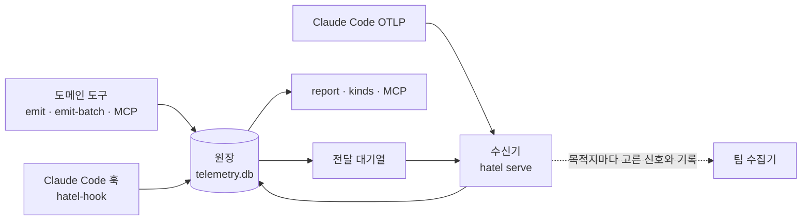
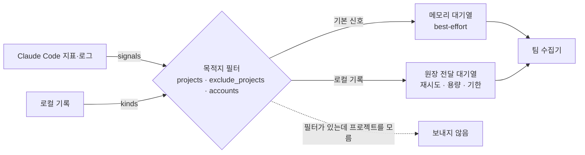

# hatel

[](https://github.com/junyeong-ai/hatel/actions/workflows/ci.yml)

> **한국어** | **[English](README.en.md)**

**로컬 텔레메트리 원장입니다.** 검사 실행 결과, 도메인 이벤트, 상태 스냅샷, Claude Code 사용량을 SQLite 원장 하나에 기록하고 CLI와 MCP로 조회합니다. 기본 설정에서는 아무것도 외부로 보내지 않습니다.



## 무엇에 쓰나요

| 질문 | 기록하는 것 | 해석할 때 주의할 점 |
|---|---|---|
| 이 저장소에서 무엇을 실행했나요? | 훅이 남긴 도구 호출·프롬프트·지침 로드와 저장소 단위의 프로젝트 | 표시 이름이 같은 저장소는 함께 묶일 수 있습니다. |
| 검사는 어디서 시간을 썼나요? | 공통 `check` Kind의 결과와 소요 시간 | 실패가 곧 결함이나 불안정성을 뜻하지는 않습니다. |
| 규칙·리뷰·배포 상태는 어떤가요? | 직접 정의한 도메인 Kind와 상태 스냅샷 | 생산자가 기록하지 않은 사실은 알 수 없습니다. |
| 기간 동안 모델·에이전트별로 얼마를 썼나요? | `claude.api_request`의 요청 비용 추정치 | 청구서가 아닙니다. |
| 조직에 무엇을 보낼까요? | 목적지마다 고른 기본 신호와 로컬 Kind | 로컬 저장과 외부 전달의 성공은 별개입니다. |

hatel은 Claude Code의 [기본 모니터링](https://code.claude.com/docs/en/monitoring-usage)을 다시 만들지 않고 그 위에 필요한 신호만 더합니다. 범용 OTLP Collector, 분산 추적 백엔드, 청구 원장, 생산성 평가 도구를 대신하지 않습니다.

## 시작하기

```sh
curl -fsSL https://raw.githubusercontent.com/junyeong-ai/hatel/main/scripts/install.sh | bash
hatel emit check name=lint suite=quality outcome=passed duration_s:=1.25 --receipt
hatel report --kind check --window 7d
```

설치기는 `hatel`, `hatel-hook`, Claude Code 스킬을 설치합니다. `--version <version>`으로 배포본을 고르고, 체크아웃에서는 `bash scripts/install.sh --source`로 빌드합니다. `scripts/uninstall.sh`는 수집한 데이터와 설정을 남깁니다.

로컬 기록과 조회에는 Claude Code도 수신기도 필요하지 않습니다. Claude Code 사용량까지 모으려면 다음을 실행합니다.

```sh
hatel init                          # 사용자 settings.json에 텔레메트리 환경과 훅을 연결
hatel service                       # 수신기를 백그라운드 서비스로 실행 (launchd / systemd --user)
claude mcp add hatel -- hatel mcp   # 에이전트가 쓸 MCP 도구를 등록
hatel doctor                        # 연결 상태 확인
```

`init`은 기존 훅과 조직 목적지를 보존합니다. `--scope project`와 `--scope local`은 훅만 연결합니다. 관리 정책이 훅이나 목적지를 잠그면 `doctor`가 가능한 범위를 알려 줍니다.

## 질문별 명령

| 알고 싶은 것 | 명령 |
|---|---|
| 기록할 수 있는 Kind와 필드 | `hatel kinds --json` |
| 최근 30일 요약과 세션 비용 | `hatel report --window 30d` |
| 지난 7일의 모델별 요청 비용 | `hatel report --kind claude.api_request --group-by model --window 7d` |
| 실패한 검사 | `hatel report --kind check --filter outcome=failed --group-by name --top 0` |
| 성공한 스킬 호출 | `hatel report --kind tool --filter tool_name=Skill --filter ok=1 --group-by skill` |
| 컨텍스트에 로드된 지침 파일 | `hatel report --kind memory --group-by file_path` |
| 한 브랜치에서 시작한 세션 | `hatel report --kind session --filter branch=main --group-by session_id --top 0` |
| 현재 저장소만 | `hatel report --project "$PWD"` |

`--filter`(반복 가능, 정확히 일치), `--group-by`, `--sort-by`는 `--kind`와 함께 씁니다. `--top`은 목록마다 기본 5개를 보여 주고 `0`이면 전부 보여 주며, 자르기 전 개수도 함께 알립니다. 기계가 읽을 때는 `--format json`을 씁니다. `--project`에 경로를 주면 그 경로가 속한 저장소(linked worktree 포함)를 고르고, 저장소 밖의 경로는 거부합니다.

## 결과 읽는 법

- **합계는 측정 개수와 함께 읽습니다.** `sum`은 `valid_count`와 함께 봅니다. 사람용 표에서 `—`는 측정값 없음, `7 (1/3)`은 기록 3개 중 측정된 1개의 합계, `0`은 실제로 측정된 0입니다.
- **빈 결과가 0이라는 뜻은 아닙니다.** 섹션의 `error`, `storage_error`, `cost_error`, `unreadable_kinds`를 먼저 확인합니다.
- **보존 범위를 확인합니다.** `retained_since`는 남아 있는 가장 오래된 기록의 시각입니다. 기간 시작(`since`)보다 늦으면 기간 앞부분에는 보존된 기록이 없습니다.
- **비용 기준은 두 가지입니다.** `cost` 섹션은 마지막 활동 시각으로 고른 세션의 누적값(`cost_basis`)이고, 기간 안에 발생한 요청 비용은 `claude.api_request`로 조회합니다. 둘 다 청구액이 아니며, `session`의 캐시 쓰기 예상 비용은 예측이므로 여기에 더하지 않습니다.
- **`identity`를 선언한 이벤트 Kind는** 그룹마다 ID별로 가장 이른 기록 하나를 셉니다. 저장할 때 중복을 지우는 것은 아닙니다.

각 Kind 섹션은 현재 계약으로 답하고, 계약이 다른 기록은 `contracts`에 `resolution`별 건수로 알립니다.

| `resolution` | 기록의 계약 | 집계 |
|---|---|---|
| `selected` | 답하는 정의 자체 | 포함 |
| `compatible` | 이름·버전·모드(스냅샷이면 identity도)가 같고, 답하는 정의가 선언한 필드의 타입·단위·해시 처리가 같으며, 그 정의의 필수 필드가 기록 당시에도 필수 | 포함 |
| `incompatible` | 위 조건을 벗어남 | 건수만 |
| `undefined` | 정의를 알 수 없음 | 건수만 |

저장된 다른 계약으로 답하려면 `hatel kinds --json`의 `stored_contracts`에서 `schema_id`를 찾아 `--kind`와 함께 `--contract`로 지정합니다. 더 쓰지 않는 Kind도 이렇게 조회합니다.

## 커스텀 Kind

스키마 TOML은 데이터 계약만 정의하고, 실행 결과와 판정은 그 사실을 아는 생산자가 기록합니다. 단순한 명령 실행에는 공통 `check`를 쓰고, 도메인 고유의 의미가 생길 때만 `team.deploy`처럼 네임스페이스가 있는 Kind를 만듭니다. 스키마 파일은 `config.toml`의 `plugins`에 추가합니다.

```toml
[[kind]]
name = "team.deploy"
version = 1
fields = { service = { type = "string", required = true }, outcome = { type = "string", required = true }, duration_s = { type = "number", unit = "s" }, actor = { type = "string" } }
group_key = "service"
measures = ["duration_s"]
redact = ["actor"]
```

```sh
hatel emit team.deploy service=api outcome=passed duration_s:=3.2 --receipt
hatel emit team.deploy --json '{"service":"api","outcome":"passed"}' --context '{"source":"release-tool","run_id":"run-123"}'
printf '%s\n' '[{"kind":"check","payload":{"name":"lint","outcome":"passed"}}]' | hatel emit-batch
```

- 필드 타입은 `string`, `number`, `integer`, `boolean`, `array`, `object`, `any`이고 필수 여부와 단위를 선언합니다. `redact`에 적은 필드는 저장 전에 해시 처리합니다.
- 타입이 틀리거나 필수 필드가 빠진 기록은 저장 전에 거절합니다. 선언하지 않은 페이로드 필드는 경고 후 제거하고, `HATEL_STRICT=1`이면 거절합니다.
- `key=value`는 문자열, `key:=value`는 JSON입니다. `--context`는 `occurred_at`, `source`, `run_id`, `correlation_id`를 받습니다.
- 공통 `metadata.project`는 실행 디렉터리의 Git 저장소로 정합니다. 저장소 밖에서는 프로젝트를 만들지 않습니다.
- 영수증은 로컬 저장을 확인합니다. `delivery`는 전달 대기열 등록 결과이며 외부 수신을 뜻하지 않습니다.

| 종료 코드 | `emit` | `emit-batch` |
|---|---|---|
| 0 | 저장됨 | 모두 저장됨 |
| 1 | 설정·레지스트리·저장소를 쓸 수 없음 | 일부 항목이 저장되지 않음 |
| 2 | 입력이 검증에서 거절됨 | 항목을 처리하기 전에 호출이 실패함 |

배치는 항목별 `stored`·`rejected`·`failed`를 입력 순서대로 돌려주고 전체가 원자적이지 않으므로, 저장되지 않은 항목만 다시 보냅니다. 한도는 CLI 표준 입력 8MiB, 배치 4096개, 정제된 페이로드 256KiB입니다. MCP SDK는 16MiB를 넘는 메시지를 응답 없이 버립니다.

### 상태 스냅샷

```toml
[[kind]]
name = "team.review"
mode = "snapshot"
identity = "review_id"
fields = { review_id = { type = "string", required = true }, outcome = { type = "string" }, unresolved = { type = "integer" } }
group_key = "outcome"
measures = ["unresolved"]
```

스냅샷 보고서는 기간 안에서 프로젝트와 ID별 최신 기록을 먼저 고른 뒤 필터와 그룹화를 적용합니다. 그래서 최신 상태가 해결됨이면 `unresolved` 필터가 예전 상태를 되살리지 않습니다. 기간 안에 바뀌지 않은 항목은 빠지므로 결과가 현재의 전체 목록은 아닙니다.

### 계약 변경

| 변경 | 이전 기록 |
|---|---|
| 선택 필드 추가, 필드 제거, 필수 필드를 선택으로 변경 | 계속 읽습니다 |
| 타입·단위·해시 처리 변경, 새 필수 필드, 스냅샷 identity 변경 | 읽지 않고 건수만 셉니다 |
| `group_key`·`measures` 변경 | 계약이 바뀌지 않습니다 |

의미를 바꿀 때는 Kind 이름이나 `version`을 명시적으로 바꿉니다. 호환되지 않는 계약으로 바뀌었거나 제거된 필드를 담은 전달 대기 기록은 취소됩니다.

### 훅 바인딩

라이프사이클 훅 입력에 실제로 있는 필드는 선언적 바인딩으로 기록할 수 있습니다(`from`, JSON Pointer, `const`, `len`, `when` 조건 등). 도구 이름이나 자유 텍스트로 배포 성공이나 품질을 추론하지 않습니다. 형식은 [예제](plugins/example.toml)를 참고합니다.

## 저장과 보존

설정 파일은 `$HATEL_CONFIG`, 없으면 플랫폼의 `hatel/config.toml`입니다(Unix `~/.config/hatel/config.toml`, Windows `%APPDATA%\hatel`). 훅·CLI·MCP·수신기가 모두 이 파일을 읽습니다.

```toml
plugins = ["schemas/team.toml"]

[storage]
# state_dir = "/data/hatel"
retention_days = 90

[storage.kinds."claude.hook"]
retention_days = 14
```

- 원장은 상태 디렉터리의 SQLite 데이터베이스 `telemetry.db` 하나입니다. 상대 경로는 설정 파일 기준이며 `~`는 확장하지 않습니다.
- `retention_days`는 모든 Kind의 기본 보존 일수이고, `[storage.kinds."<Kind>"]`는 그 Kind만의 일수를 정합니다.
- 수신기가 보존 기간이 지난 기록을 주기적으로 지우고 비워진 공간을 파일 시스템에 돌려줍니다. 줄인 보존 기간은 수신기를 재시작한 뒤부터 적용되며, 설정 파일을 읽지 못하면 아무것도 지우지 않습니다.
- `hatel doctor --local`이 실제 설정 파일과 원장, 원장 크기, 기록이 가장 많은 Kind를 알려 줍니다.
- 이 빌드가 만들지 않은 스키마의 저장소는 읽기와 쓰기를 거부하고 변경하지 않습니다. `telemetry.db`를 옮기면 새 저장소로 시작합니다. 실행 중인 원장은 [SQLite backup API](https://www.sqlite.org/backup.html)로 백업합니다.

| 변수 | 용도 |
|---|---|
| `HATEL_CONFIG` | 설정 파일 선택 |
| `HATEL_PLUGINS` | 한 프로세스의 플러그인 목록 대체 (Unix `:`, Windows `;` 구분) |
| `HATEL_STATE_DIR`, `HATEL_RETENTION_DAYS`, `HATEL_ROTATE_BYTES` | 한 프로세스의 `[storage]` 값 대체 |
| `HATEL_DISABLED=1` | 로컬 기록 끄기 |
| `HATEL_STRICT=1` | 선언하지 않은 페이로드 필드 거절 |
| `HATEL_TESTING=1` | 상태를 `_test/` 아래로 분리 |

변수는 그 변수를 받은 프로세스에만 적용되므로, 훅에만 전달하면 서비스와 원장이 갈라집니다. 공통 설정은 `config.toml`에 둡니다.

## 팀으로 전달

목적지마다 `[[export]]`를 두고 Claude Code의 기본 신호(`signals`)와 로컬 기록(`kinds`)을 따로 고릅니다.



```toml
[[export]]
endpoint = "https://collector.example.com"
mode = "enriched"
signals = ["metrics"]
kinds = ["check", "team.deploy"]
projects = ["/absolute/repository/path"]
# headers = { authorization = "Bearer ..." }
```

- `signals`를 생략하면 지표와 로그를 보내고, `kinds`를 생략하면 로컬 기록을 보내지 않습니다. `signals = []`이면 로컬 기록만 보냅니다.
- `raw`는 받은 원문을 그대로, `enriched`는 프로젝트 표시 이름을 더한 JSON을 보냅니다. 기본 신호의 원문에는 로컬 해시 처리가 적용되지 않습니다.
- `kinds`의 기록은 원장과 같은 트랜잭션으로 대기열에 들어가고, 수신기가 같은 `record_id`로 재시도합니다. 응답이 유실되면 중복 전달될 수 있습니다. 상태는 `hatel deliveries --json`으로 확인합니다.
- `accounts`는 Claude 로그인 이메일의 허용 목록입니다. 기본 신호에만 적용되므로 `kinds`와 함께 쓸 수 없습니다.
- 기존 조직 수집기 앞에 끼우려면 `hatel init --insert --mode enriched`를 실행하고 생성된 `[[export]]`를 검토합니다.

## Claude Code 어댑터

| 신호 | 로컬 처리 | 주의점 |
|---|---|---|
| 비용·토큰·활동 시간·코드 줄 수 지표 | 세션별 누적값 | `session.id`가 없는 지표는 추측하지 않고 버립니다 |
| `api_request` 이벤트 | 안전한 필드만 `claude.api_request`로 기록 | 요청 비용 추정치이며 청구액이 아닙니다 |
| `hook_execution_complete` 이벤트 | `claude.hook`의 완료 묶음 수와 총 소요 시간 | 개별 훅의 지연으로 나눌 수 없습니다 |
| 라이프사이클 훅 | 도구 호출·프롬프트 길이·세션 시작·서브에이전트·명령·지침 로드 | 재개할 때마다 다시 발생하는 이벤트가 있습니다 |
| OTLP traces | 지원하지 않음 (HTTP 501) | 별도의 추적 수집기를 씁니다 |

- 로컬 디코딩은 압축하지 않은 HTTP/JSON에 한정합니다. 중복 속성 키나 잘못된 타입을 빈 문자열이나 0으로 바꾸지 않습니다.
- 프로젝트는 훅이 관찰한 세션의 저장소를 우선합니다. 시작을 보지 못한 세션은 `vcs.repository.url.full`의 브라우저 URL로 식별할 수 있습니다.
- `tool`의 소요 시간은 호출이 반환될 때까지이므로 백그라운드 명령은 접수 시간만 담습니다. 지침 로드 기록이 없다고 그 파일이 컨텍스트에 없었던 것은 아닙니다.
- `session` 시작 기록은 그때 체크아웃된 브랜치를 담습니다. 브랜치의 비용은 그 세션들의 `cost` 행, 즉 세션 전체의 누적값으로 봅니다.

## 운영과 개인정보

```sh
hatel doctor --json
hatel doctor --local --json
hatel service --restart
```

- `doctor`는 Claude Code 연결까지, `--local`은 로컬 기록·스키마·저장소·전달만 확인합니다. 이 프로세스의 환경만 보므로 다른 세션의 실행 환경은 판단하지 않습니다.
- 업그레이드 후에는 `hatel service --restart`로 수신기를 재시작하고, Claude Code에서 `/mcp` → `hatel` → `Reconnect`로 MCP 서버를 다시 연결합니다. 대화는 유지됩니다.
- 수신기 로그는 macOS `~/Library/Logs/hatel/serve.log`, Linux `journalctl --user -u hatel`에 있습니다.
- 기본 Kind는 프롬프트 원문, 명령 출력, 임의의 도구 입력을 저장하지 않습니다. 원장에는 로컬 저장소 경로와 식별자가 들어가므로 민감한 데이터로 다룹니다. 해시는 익명화를 보장하지 않습니다.
- 훅의 기록 실패는 작업을 막지 않고 진단만 남깁니다. hatel은 전체 경로의 exactly-once를 보장하지 않으며, 관측 수치로 절약 시간이나 ROI를 산출하지 않습니다.

## 개발

`crates/core`는 비동기 런타임이 없는 스키마·원장·조회 라이브러리, `crates/hook`은 훅 실행 파일, `crates/cli`는 수신기·CLI·MCP입니다. 개발 규칙은 [CLAUDE.md](CLAUDE.md), 배포되는 에이전트 지침은 [SKILL.md](.claude/skills/hatel/SKILL.md)에 있습니다. 문제는 [GitHub Issues](https://github.com/junyeong-ai/hatel/issues)에 남깁니다.

## License

MIT OR Apache-2.0. See [LICENSE-MIT](LICENSE-MIT) and [LICENSE-APACHE](LICENSE-APACHE).
